<p align="center">
  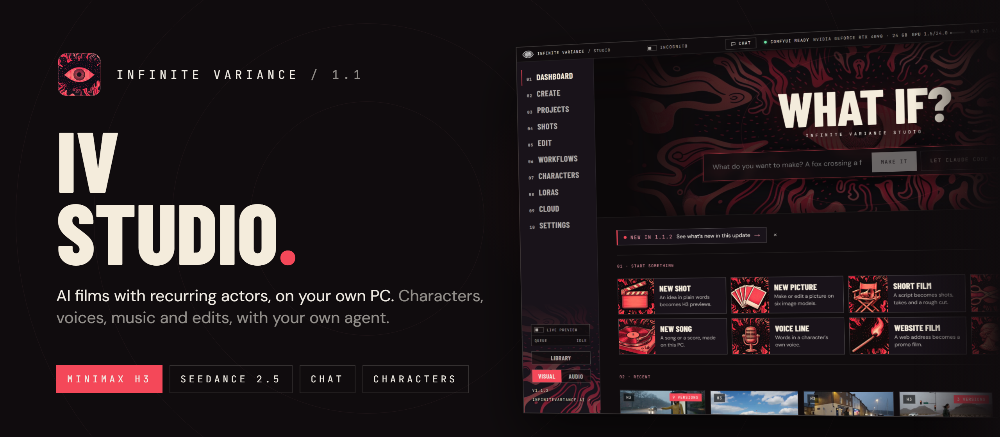
</p>

<p align="center">
  <a href="https://github.com/hollisorg/iv-studio/releases/latest/download/IV-Studio-Setup.exe"><b>Download for Windows</b></a>
  &nbsp;·&nbsp;
  <a href="https://github.com/hollisorg/iv-studio/releases/latest/download/IV-Studio.AppImage"><b>Linux (AppImage)</b></a>
  &nbsp;·&nbsp;
  <a href="#what-you-need">What you need</a>
  &nbsp;·&nbsp;
  <a href="https://github.com/hollisorg/iv-studio/releases/latest">Release notes</a>
  &nbsp;·&nbsp;
  <a href="https://infinitevariance.ai">Infinite Variance</a>
</p>

# IV Studio

A free Infinite Variance desktop app for making short films with
[MiniMax H3](https://huggingface.co/MiniMaxAI/MiniMax-H3) on your own PC. Give a recurring actor a face
and a voice, write a shot, hunt a few quick previews and finish the best one at full size. Make
pictures, songs and spoken lines, cut it all together and export. IV Studio drives your own
[ComfyUI](https://github.com/comfyanonymous/ComfyUI); nothing leaves your machine unless you choose the
cloud. No strong graphics card? Shots can also render on a GPU in your own [RunPod](https://www.runpod.io) or
[Modal](https://modal.com) account, billed by the second (see [Cloud](#cloud)).

<p align="center">
  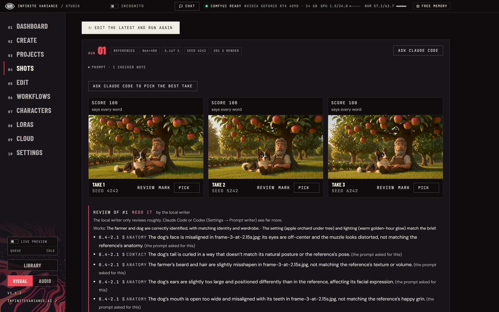
</p>

## What it does

- **Dashboard.** IV Studio opens on one-click starts for everything it makes, your latest renders and
  your cast. Every page has its own banner art.
- **Projects.** A short film as a six-step wizard for anyone: an idea, a script (written for you or your
  own), the cast and places, a storyboard of drawn sketches you can play as an animatic, filming every
  panel, and the finished film. Faces and rooms stay the same from shot to shot.
- **Shots.** Write a shot (or type the idea in plain words and let **Write it for me** write the H3
  prompt; it looks at your reference pictures and videos first), hunt one to three quick previews, pick
  one and finish it at 1 to 2 MP with DLSS, an RTX 2× upscale and frame generation, or with SeedVR2. Four
  modes: text, reference pictures, video and audio, first and last frame, and continuing a video.
- **Directing.** A prompt checker that catches H3 mistakes before you spend a render, @ mentions for your
  cast and places, live step pictures while takes render, takes ranked by words heard, likeness and
  sharpness, side-by-side Compare, a **Review** that names each problem with its seconds and one fix, and a
  top-down staging board that becomes exact screen directions or a moving grey previs.
- **Images.** Create switches between **Video** and **Image**: make or edit pictures with six image
  model families (Flux.2 Klein, Flux 3 Klein, Krea 2, Moss, Qwen Image 2.1 and Z-Image Turbo), then use
  one as a shot's first frame.
- **LoRAs.** Browse Civitai's MiniMax H3 LoRAs as tall picture cards whose clips play on hover, open one
  for a full-size gallery of its examples, and download it straight into ComfyUI. Your own LoRAs show as
  pictures too, and Create's LoRA tray adds them to a shot with a strength slider.
- **Characters.** Recurring actors as trained H3 LoRAs with a trigger word. Use the ready-made Tess and
  Theo, add a LoRA you have, or design, clip and train your own on your Modal account.
- **Voices.** Give each character a voice: design one from a description, or save one from a recording.
  Type a line and **Speak it**: the character says it on screen, lip-synced. Runs on your PC with
  VoxCPM2 and Whisper.
- **Music.** Songs with sung lyrics, or instrumentals, from a style and lyrics: MiniMax Music 3 for full
  songs up to five minutes, ACE-Step 1.5 for a draft in seconds. Put a song under an edit, or have a
  character sing it.
- **Sequences.** Several shots that play as one continuous video, rendered as one take or shot by shot,
  with retakes of any stretch.
- **Edit.** A Premiere-style editor with a full-screen workspace: project bin, source and program
  monitors, as many video and audio tracks as you need, filmstrips and waveforms, markers, J/K/L,
  insert and overwrite, razor, ripple and rolling trims, and MP4 export at 1080p, 4K, vertical or square
  at a set loudness. Right-click to make new footage on the timeline (extend, bridge, fill a gap, retake a
  stretch), cut out a person or thing with see-through edges, or reframe a shot to a new shape with H3
  drawing what lies beyond its edges.
- **Workflows.** **Sizzle** turns a website into a promo film: your agent storyboards it from the real
  site, then H3 shots, pictures, music and the site's own screens are cut together on the beat. **Reel**
  cuts pictures or clips to a song's beat. **Replace** swaps a person or an object in a video while the
  camera, motion and sound stay. **Shinobi** lets an agent cut a whole edit in code.
- **Learn.** Every feature on one searchable page, a **?** with the easy-to-miss tips on every page, and
  short tutorial videos inside the app.
- **Library and Queue.** Every shot, sequence, picture, export, song and spoken line in one place, with
  each shot's versions grouped together. Above it, the render queue shows what's rendering and what waits.
- **Cloud.** Render shots and sequences on your own RunPod or Modal account instead of your PC, with a running time
  and cost meter in the title bar and a **Shut down GPU** button.
- **Incognito.** A private space whose work never shows in the normal app.
- **Agents.** A local MCP server with 142 tools and a start menu gives Claude Code or any MCP client nearly
  everything a person can do in the window.
- **Updates.** IV Studio updates itself: one click installs a new version and reopens.

<table>
  <tr>
    <td width="50%">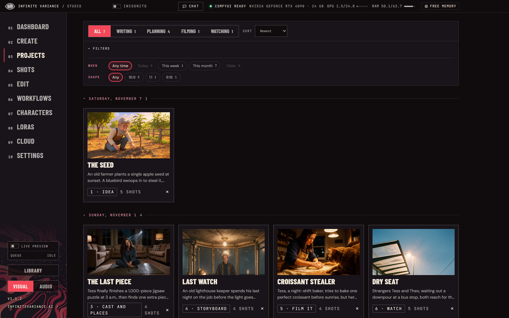</td>
    <td width="50%">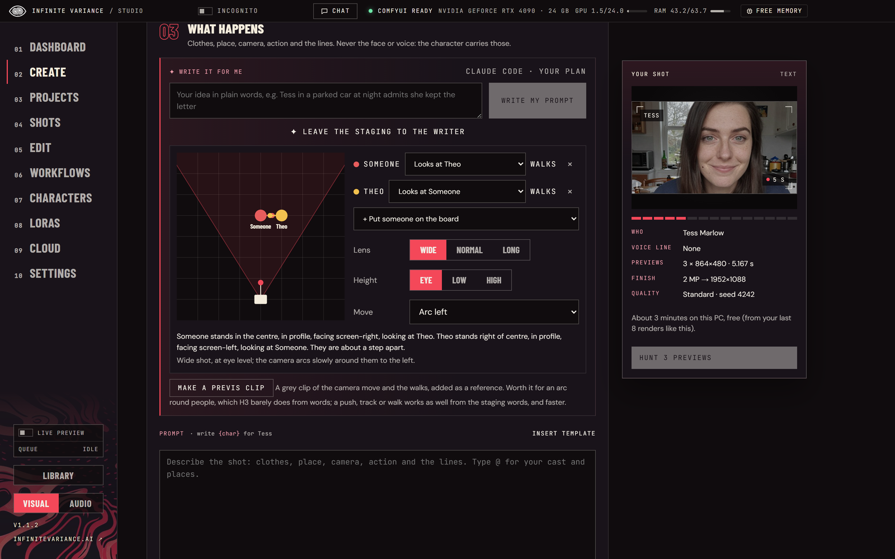</td>
  </tr>
  <tr>
    <td align="center"><sub>A short film, step by step</sub></td>
    <td align="center"><sub>Stage the shot on a board; it becomes exact directions or a previs clip</sub></td>
  </tr>
  <tr>
    <td width="50%">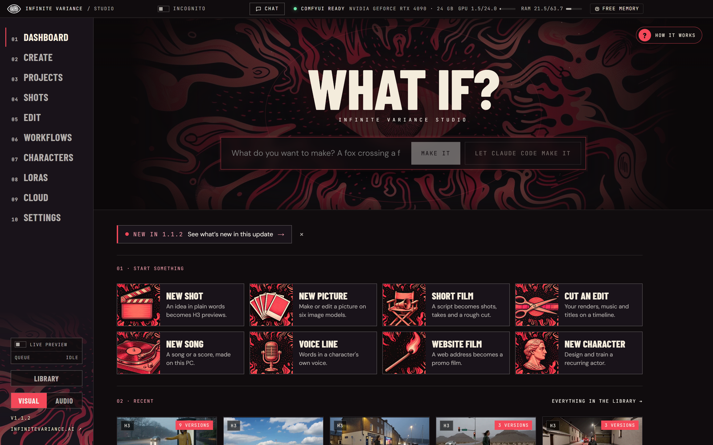</td>
    <td width="50%">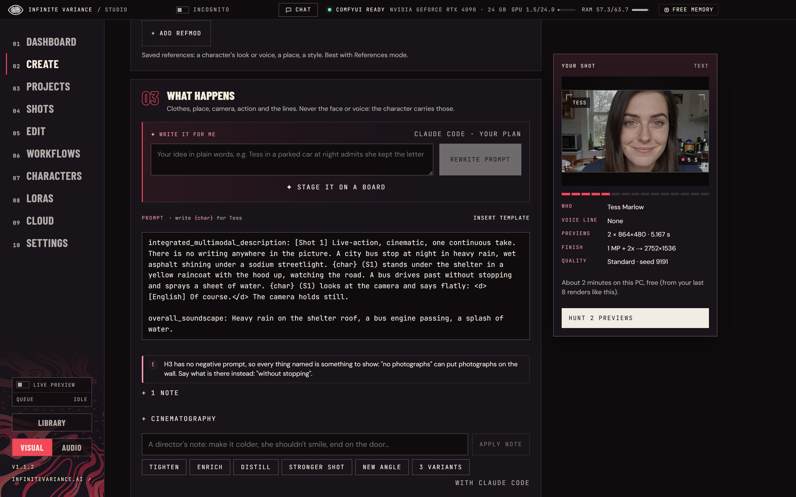</td>
  </tr>
  <tr>
    <td align="center"><sub>Start anything from the Dashboard</sub></td>
    <td align="center"><sub>Describe the shot and let it be written, with LoRAs as pictures</sub></td>
  </tr>
  <tr>
    <td width="50%">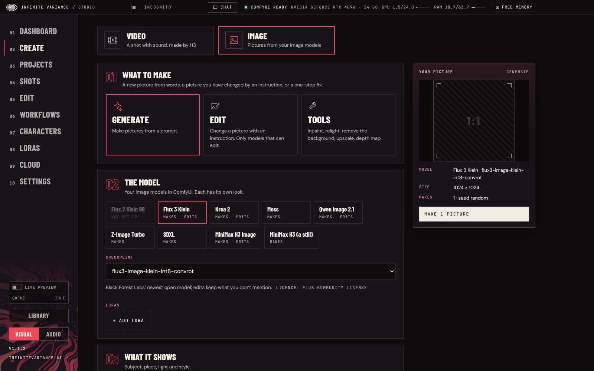</td>
    <td width="50%">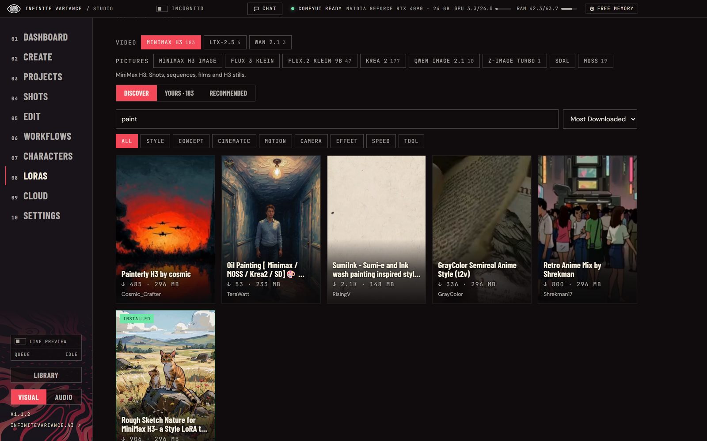</td>
  </tr>
  <tr>
    <td align="center"><sub>Pictures too: generate or edit on six model families</sub></td>
    <td align="center"><sub>Find H3 LoRAs on Civitai</sub></td>
  </tr>
  <tr>
    <td width="50%">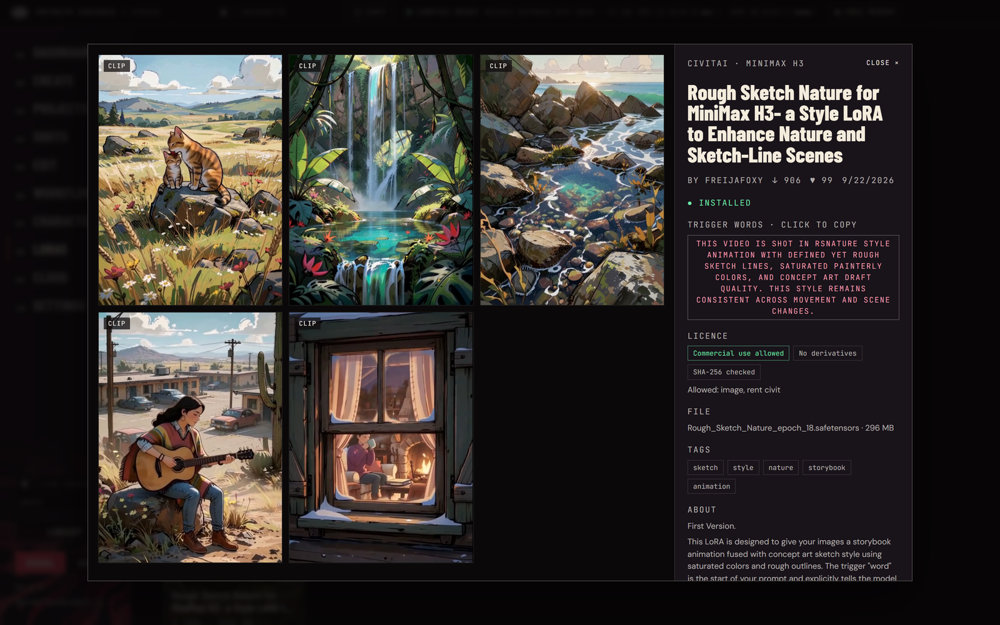</td>
    <td width="50%">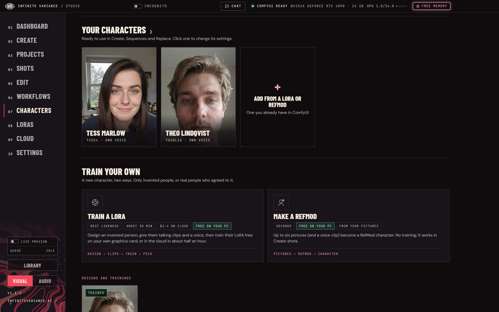</td>
  </tr>
  <tr>
    <td align="center"><sub>Every LoRA's examples, trigger words and licence</sub></td>
    <td align="center"><sub>Recurring characters, ready-made or trained</sub></td>
  </tr>
  <tr>
    <td width="50%">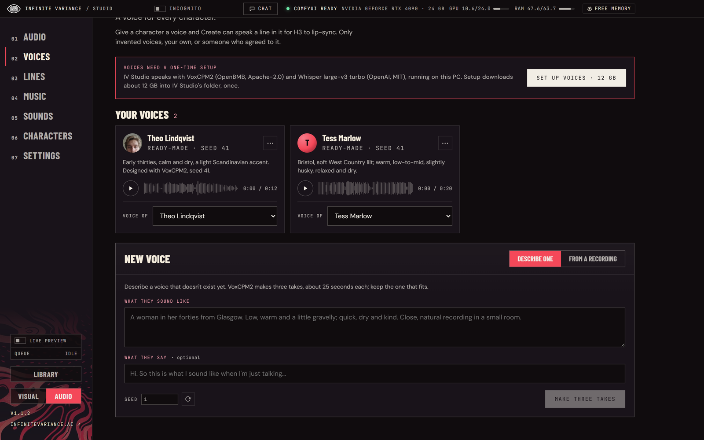</td>
    <td width="50%">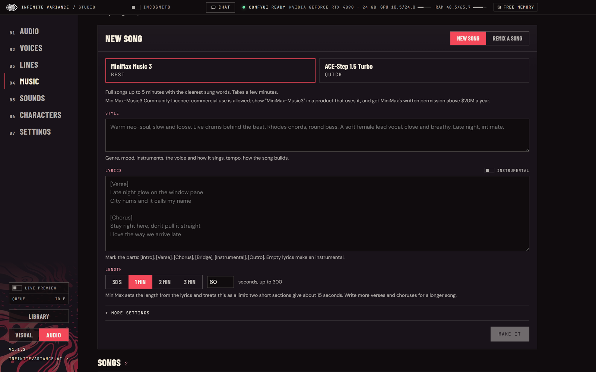</td>
  </tr>
  <tr>
    <td align="center"><sub>A voice for every character</sub></td>
    <td align="center"><sub>Songs and scores, made on your PC</sub></td>
  </tr>
  <tr>
    <td width="50%">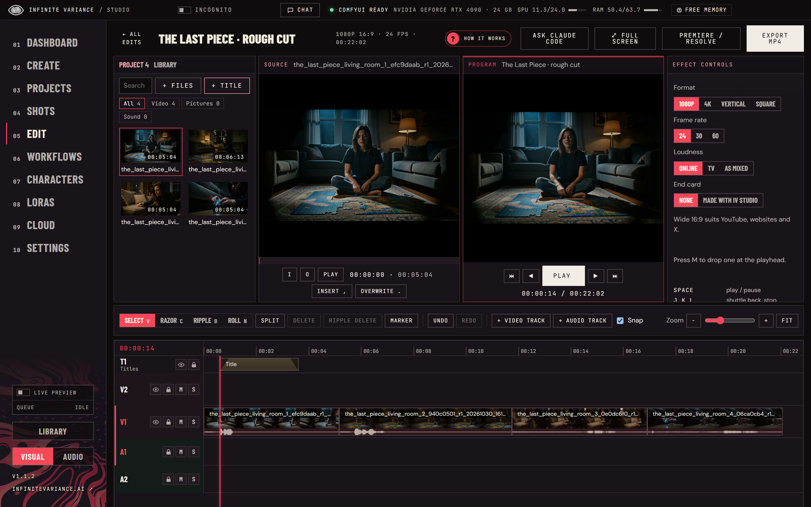</td>
    <td width="50%">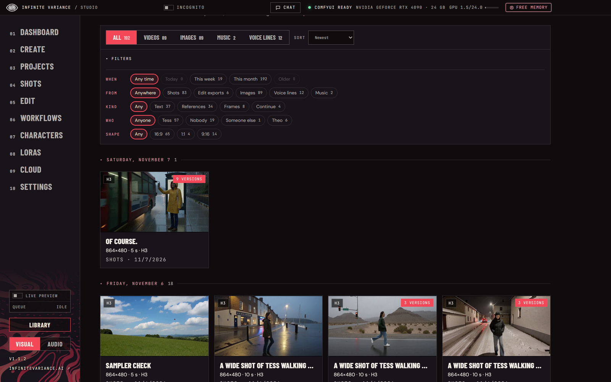</td>
  </tr>
  <tr>
    <td align="center"><sub>A Premiere-style editor, full screen, with your agent cutting alongside</sub></td>
    <td align="center"><sub>Everything you've made, in one place</sub></td>
  </tr>
  <tr>
    <td width="50%">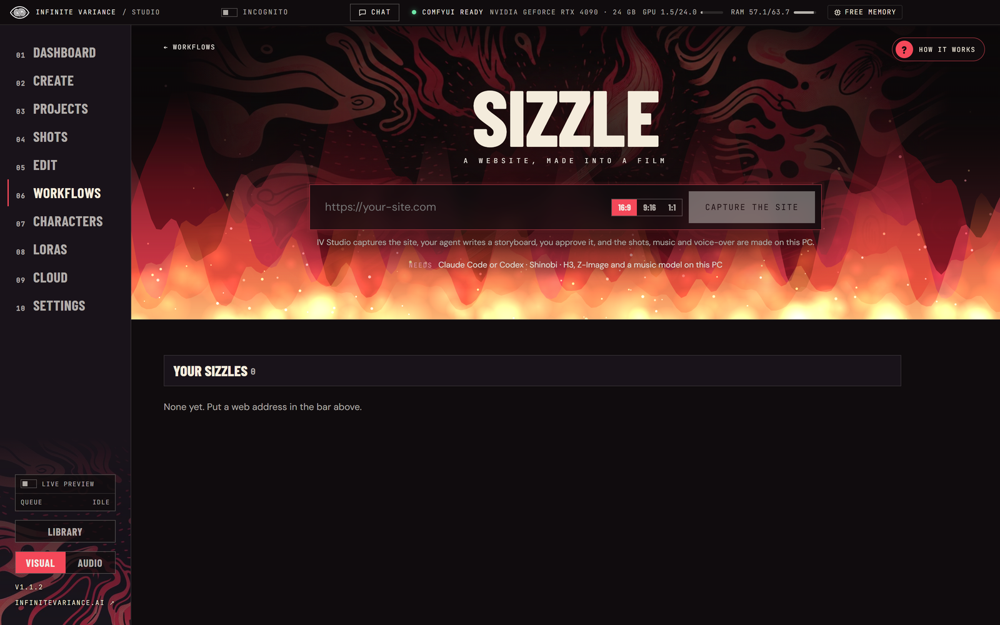</td>
    <td width="50%">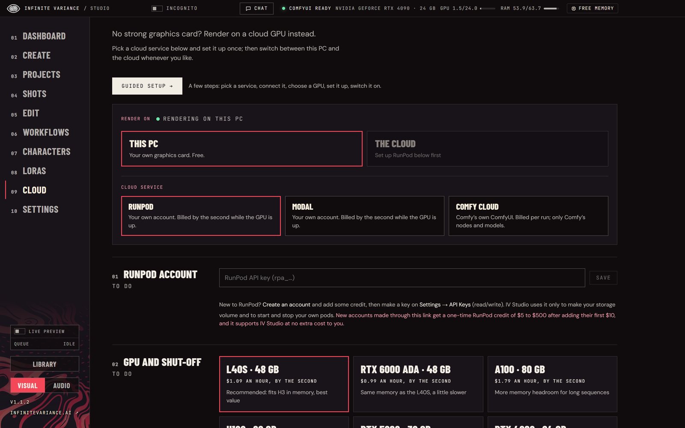</td>
  </tr>
  <tr>
    <td align="center"><sub>A website, made into a promo film</sub></td>
    <td align="center"><sub>No big GPU? Render on your own Modal account</sub></td>
  </tr>
</table>

## What you need

- **Windows 10 or 11** (64-bit), or **64-bit Linux** (the AppImage, from 0.2.8; see [Linux](#linux)).
- **An NVIDIA GPU, or the cloud.** 24 GB of VRAM is what IV Studio is tested on (an RTX 4090); 16 GB works
  with smaller previews and finals. 64 GB of system RAM is recommended. Without a suitable card, shots and
  sequences can render on a cloud GPU in your own RunPod or Modal account; pictures, music and voices still need a
  local NVIDIA GPU (see [Cloud](#cloud)).
- **[ComfyUI](https://github.com/comfyanonymous/ComfyUI)**, version 0.33 or newer, running on the same PC.
  IV Studio talks to it at `http://127.0.0.1:8188` (change it in Settings). It can start ComfyUI for you: it
  finds your ComfyUI shortcut, the ComfyUI Desktop app or a portable install's `run_nvidia_gpu.bat` (or you pick one
  in Settings → ComfyUI, or pick your ComfyUI folder and the start file in it), starts it when IV Studio opens, and
  offers **Start ComfyUI** whenever it isn't running.
- **Disk space.** About 60 GB for the H3 models. Music adds about 14 GB (MiniMax Music 3) or 10 GB
  (ACE-Step); voices add about 12 GB. Each is a one-click download inside the app.
- **Optional:** [Ollama](https://ollama.com) for the free local prompt writer, and a
  [Modal](https://modal.com) account (cloud rendering and character training) or a
  [RunPod](https://www.runpod.io) account (cloud rendering).

## Install

1. [Download `IV-Studio-Setup.exe`](https://github.com/hollisorg/iv-studio/releases/latest/download/IV-Studio-Setup.exe)
   (about 180 MB).
2. Run it. The installer isn't code-signed yet, so Windows may show **"Windows protected your PC"**.
   Click **More info → Run anyway**. It installs for your user only; no admin rights needed.
3. Start ComfyUI, then IV Studio. **Settings → Setup** checks ComfyUI, your GPU, the node packs and every
   model, downloads missing models straight into ComfyUI's models folder (each checked against the
   SHA-256 its host publishes) and links any node pack you still need.
4. For voices, open **Audio → Voices** and press **Set up voices** once. For music, open
   **Audio → Music** and download the engine you want.

Your projects, voices and songs are kept in `%APPDATA%\IV Studio`; renders are saved in ComfyUI's
output folder under `H3\`.

### Linux

1. [Download `IV-Studio.AppImage`](https://github.com/hollisorg/iv-studio/releases/latest/download/IV-Studio.AppImage)
   (about 240 MB), make it executable (`chmod +x IV-Studio.AppImage`) and run it. AppImages need FUSE
   (`libfuse2`, called `libfuse2t64` on Ubuntu 24.04).
2. IV Studio finds a ComfyUI folder in your home folder (or pick it in Settings → ComfyUI) and starts it with
   a `.sh` script beside it, or with its `main.py` and the folder's own `venv` Python. ComfyUI's output goes to
   `comfyui.log` in IV Studio's data folder, `~/.config/IV Studio`.
3. Saving API keys (Civitai, RunPod, Comfy.org) needs a keyring (GNOME Keyring or KWallet).
4. Shinobi, previs and website capture use Google Chrome, Chromium or Microsoft Edge.

What's different: DLSS 5 is Windows-only, so finals use a 2× AI upscale (Real-ESRGAN) and RIFE frame
interpolation when those are installed in your ComfyUI, as in the cloud. The Linux build is built and checked on
GitHub's Ubuntu machines (every page, the agent server, Shinobi and website capture); renders on a Linux GPU
haven't been tried yet. In Settings → Agents, the command for Claude Code or Codex runs a small script that opens
the AppImage, so it keeps working after updates.

**Updates.** From 0.2.1 on, IV Studio checks for a new version when it starts and every six hours, and
downloads it in the background. Click **↻ Update to …** at the bottom of the sidebar (or **Restart to
update** in Settings → Updates) to install it and reopen; otherwise it installs the next time you quit.
It waits while an edit is exporting or models are downloading. Coming from 0.2.0 or older, install 0.2.1
by hand once.

<p align="center">
  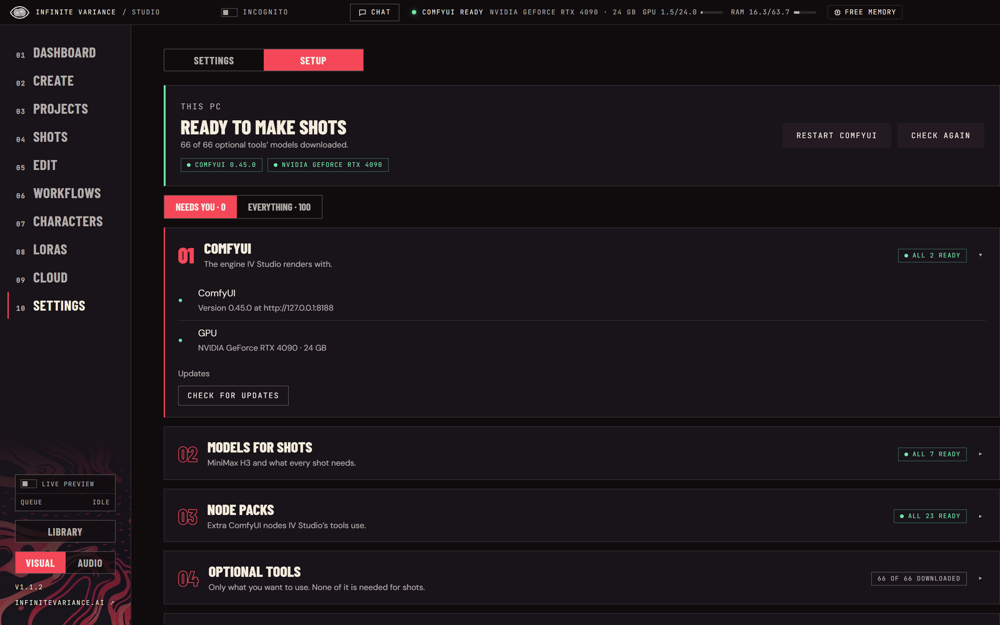
</p>

### macOS

IV Studio builds for Macs with Apple silicon (M1 or newer). There is no download on the releases page for it
yet: you build the disk image yourself.

1. On an Apple silicon Mac, run `npm ci`, then `npm run dist:mac`. The build needs an Apple silicon Mac
   (`dist:mac` stops early if the bundled FFmpeg isn't arm64). It writes `dist/IV-Studio-<version>-arm64.dmg`.
2. Open the `.dmg` and drag **IV Studio** into **Applications**.
3. **The first time you open it,** right-click **IV Studio** in Applications and choose **Open**, then **Open**
   again. If macOS still refuses, clear the quarantine flag and open it again:
   `xattr -dr com.apple.quarantine "/Applications/IV Studio.app"`.
4. Install and start [ComfyUI Desktop](https://www.comfy.org/download). IV Studio needs it on the same Mac; it
   can start it for you.

What's different: builds are signed with an ad-hoc signature, not an Apple developer certificate, and are
**not notarized**, which is why macOS asks you to confirm the first open. The Mac build never checks for
updates. Rebuild to get a new version. The switch is the `MAC_UPDATES` constant in `src/shared/platform.js`;
a working Mac update feed would also need a `zip` target in the build and a Developer ID signature, because
macOS won't update an ad-hoc signed app. The Mac FFmpeg is for personal builds only until a redistributable build
replaces it (tracked separately); see `THIRD_PARTY_NOTICES.md`.

## Dashboard

IV Studio opens on the **Dashboard**: one-click starts for a shot, a picture, a longer scene, an edit, a song,
a voice line, a website film or a new character; your eight most recent renders; and your cast, each with
their face, their voice, and **New shot** to start a shot with them already picked.

Every page opens on its own banner, drawn in the Infinite Variance eye style: a clapperboard for Shots,
scissors for Edit, a storm cloud for Cloud, a record player for Music, and so on.

## How a shot works

1. **Create.** Pick a mode, a character and write the shot.
   - **Text:** just the prompt.
   - **References:** pictures, videos or audio guide the shot (`<Picture 1>`, `<Video 1>`, `<Audio 1>`).
     Click a reference to crop or trim it; videos snap to H3's lengths. **Size: Fit for H3** resizes a
     picture or video to H3's own sizes (about 0.5, 1 or 2 MP, both sides on a 32-pixel grid, video at
     24 fps), which some modes, like Retake, need.
   - **First / last frame:** the clip opens on a picture and can end on a second one.
   - **Continue a video:** carries a clip on from its last frames.

   Set the aspect, length, preview size and how many previews to hunt (1 to 3). Optional extras: a voice
   line to lip-sync, RefMods, extra LoRAs and the step count.
2. **Hunt.** IV Studio queues the previews on ComfyUI and shows them as they finish.
3. **Pick and finish.** Choose a preview and set the final size (1, 1.5 or 2 MP), the enhancer and the
   sound source. The finish starts from the preview's own latent, so the motion stays the same.
   - **DLSS 5** (the default): RTX 2× upscale and frame generation (30/50/60/120 fps), seconds per shot.
   - **SeedVR2** (3B): restores face, eye and hair detail and upscales to 1080p, 1440p or 2160p, on any
     NVIDIA card. **Enhance** runs either one again on a finished shot.
4. **Shots.** Every shot keeps its runs, previews and finals. **Show in folder** opens the file.

### Before and after a render

- **Prompt checker.** Before a hunt, IV Studio checks the prompt the way H3 reads it: the real length on
  H3's frame grid, blank fields, the opening line a mode needs, cut times, too many words for the seconds,
  quotes and speaker names around spoken lines, references named but not attached, a LoRA character's face
  described in words, filler words and unknown @ names. Most findings have a **Fix**; errors hold the hunt
  until you fix them or choose **Render anyway**.
- **@ mentions.** Type @ for your cast and places. The picked character becomes `{char}`; anyone else with a
  picture is attached as a reference, and a text shot switches to References mode by itself.
- **Draft or Standard.** Draft previews take 4 steps instead of 8, roughly 40% faster, for hunting ideas.
- **Live previews.** Each take's step pictures stream to the page while it renders (H3's tiny decoder
  through KJNodes), so a bad take shows itself in about 20 seconds.
- **Ranked takes.** When a run finishes, the takes are scored: the spoken words Whisper hears back, likeness
  to the character (InsightFace), no frozen stretches and sharpness. The best is marked only when it clearly
  leads, with the reasons in words, and every pick you make tunes the weights.
- **Runs as versions, and Compare.** Each run shows what changed since the last, the prompt as written and as
  rendered, and a word diff. **Compare** plays two takes side by side or as a wipe, in step. **Edit and run
  again** renders into the same shot.
- **Review a take.** Your prompt writer watches six frames of a take (and reads what Whisper heard), names
  each problem with its seconds, says what works and picks one fix: revise the prompt, change a reference,
  split the action, use a clean stretch, or fix it in the edit. It remembers the shot's earlier reviews, so
  a problem that came back after a rewrite gets a different kind of fix.
- **Staging board.** A top-down floor with up to four people (where they face, who they look at, where they
  walk) and the camera (lens, height, ten moves). It becomes exact screen-side directions in the prompt, and
  warns when a cut crosses the 180-degree line. For arcing moves, **Make a previs clip** renders the board in
  motion as a grey clip that H3 follows as `<Video 1>`.

The directing rules the writers and the review follow (purpose first, staging by screen side, no padding,
frame the action) are Matthew Hollis's own method, built into `src/service/directing.js`.

### Write it for me

You don't need to know H3's prompt format. Type the idea in plain words, for example "Tess in a parked
car at night admits she kept the letter", and press **Write my prompt**. You get a finished H3 prompt
back to edit, keep or undo. It always uses your mode, length, aspect, character and media. Choose the
writer under **Settings → Prompt writer**:

- **Local (free):** a model in Ollama on your PC with IV Studio's H3 rule sheet. The recommended model is
  `huihui_ai/qwen3-vl-abliterated:8b-instruct` (about 6 GB, one click to install), huihui-ai's uncensored
  copy of Qwen3-VL 8B Instruct (Apache-2.0), so it doesn't refuse mature ideas. Any other Ollama model works
  too, including the original `qwen3-vl:8b-instruct`. While ComfyUI is rendering it runs on the CPU, so it
  never takes H3's VRAM.

  **It looks before it writes.** Add your references first: the writer is shown your reference pictures,
  two frames of each reference video, your first and last frames, and the last frame of a video you're
  continuing (up to six images, labelled `<Picture 1>`, `<Video 1>` and so on), and writes what it sees.
  It tells you what it will look at, or that the model you chose can't see pictures.
- **Claude Code or Codex:** if you have either installed and signed in, it writes with your own login,
  headless and with no tools but reading your reference pictures. It gets MiniMax's own H3 prompt guide
  (downloaded from MiniMax on first use, not shipped) and the full directing method.
- **MiniMax Context IR:** MiniMax's own prompt rewriter through ComfyUI, paid through your Comfy.org
  account (about $0.02 to $0.11 a prompt). Your API key is stored encrypted on your PC.

## Projects: a short film in six steps

**Projects** turns an idea into a finished short film, one step at a time, with a storyboard you can see.

1. **Idea.** What it's about, the format (16:9, vertical or square) and the length.
2. **Story.** **Write it for me** drafts a script from the idea, cast and length with the local writer, or
   write it in plain words, or bring a `.txt` or `.fountain` screenplay.
3. **Cast and places.** Speakers are played by your characters. Someone you made up gets a face drawn from
   their description, or from your own picture, and keeps it in every shot. Places get a description and a
   picture (drawn for you if you have none), plus **More angles** (a quarter turn, the side and a wide view,
   drawn with the QMA camera-angles LoRA for Qwen Image 2.1). Pick the film's look from six styles or your
   own words and LoRAs.
4. **Storyboard.** The writer plans each scene into 3 to 10 second shots with staging and where each one
   ends, writes each H3 prompt, and every panel gets a sketch that keeps your characters' faces and the
   room. Open a panel to change the action, camera, speaker, line or length, draw it on the staging board,
   use a recording of the line, or carry straight on from the shot before in one take. **Play the
   animatic** shows the whole film as sketches with the lines spoken.
5. **Film it.** Every panel is filmed from its sketch (2 or 3 takes), in References mode with the place's
   picture and the faces on screen, so the room and the people hold. Lines are spoken first in each
   character's own voice and read back with Whisper until the words match. Pick a take, and it finishes at
   2 MP.
6. **Watch.** The takes play in order; **Save the film as a video** exports the rough cut, and **Fine-tune in
   the editor** opens it in Edit.

## Images

**Create** switches between **Video** (a shot) and **Image** at the top. Image makes pictures on your PC with
the image models you have in ComfyUI:

| Family | Generate | Edit | Licence |
|---|---|---|---|
| Flux.2 Klein 9B | ✓ | ✓ several reference pictures | FLUX Non-Commercial (9B) |
| Flux 3 Klein | ✓ | ✓ | FLUX Kommunity |
| Krea 2 | ✓ | ✓ with the Krea 2 Identity Edit LoRA and the comfyui-krea2edit nodes | see Krea 2's model page |
| Moss | ✓ | needs a newer ComfyUI | Apache-2.0 |
| Qwen Image 2.1 | ✓ | ✓ up to three references | Apache-2.0 |
| Z-Image Turbo | ✓ | ✗ | Apache-2.0 |

Pick **Generate** or **Edit**; Edit lists only the families that can. Pick a family and one of its
checkpoints (your fine-tunes are there too), add that family's LoRAs from the same picker as Video's, then
the size, how many (1 to 4) and a seed. Each graph follows ComfyUI's official template for its model.

Finished pictures appear under the form and in the **Library**. Open one to **Use in a shot** (it becomes the
shot's first frame), **Edit this**, **Add to edit**, **Make more like this** or **Show file**. Agents use
`list_image_models` and `make_image`.

## Characters

A character is a trained MiniMax H3 LoRA plus its trigger word; write `{char}` in the prompt where the
character goes. On the **Characters** page:

- **Your characters:** each with its picture, trigger, strength, LoRA (checked against ComfyUI) and voice.
- **Ready-made:** IV Studio's own invented characters, Tess Marlow and Theo Lindqvist. Download one and
  its LoRA (about 150 MB, from this repo's `characters-v1` release, checked against its SHA-256) goes into
  ComfyUI, and their bundled voice comes with them.
- **Train your own,** the method that made Tess:
  1. **Design:** describe the face; Z-Image Turbo renders four candidates on your PC. The one you pick is
     rendered in eight scenes on the same seed. Or add your own pictures, only of an invented person or
     someone who agreed.
  2. **Clips:** H3 renders talking clips from the stills and the character's voice, or you add your own.
     Everything is fitted to Fizgig's rules (24 fps, 17n+5 frames, 32 kHz stereo).
  3. **Train:** Fizgig on your own Modal account, with the minutes and dollars shown first. Theo took
     56 minutes and about $4.10 on an H200.
  4. **Pick:** checkpoints are rendered side by side on one seed; the one you choose becomes a character,
     keeping the voice its clips were made with.

  **Likeness:** with InsightFace's face models (a one-time 289 MB download; non-commercial licence), IV
  Studio scores every still and clip against the picked face and can keep the closest of each scene.

## LoRAs

**LoRAs** (on the Visual side) changes how H3 looks and moves: styles, motion, camera, speed.

- **Discover** searches [Civitai](https://civitai.com)'s MiniMax H3 LoRAs: tall cards whose preview fills
  the card and plays on hover, filters (style, concept, cinematic, motion, camera, effect, speed, tool) and
  sorting. Open one for a pop-up with a gallery of up to 16 examples (click one for a full-size view with
  its generation prompt and settings, when Civitai has them), the maker, versions, trigger words to copy,
  the licence (whether commercial use is allowed), tags and the maker's notes, then **Download**: the file
  goes into ComfyUI's `loras\Civitai\<model>\` folder, checked against the
  SHA-256 Civitai publishes. Downloading needs your own free Civitai API key (**Settings → Civitai**; it's
  stored encrypted on your PC). Searching doesn't.
- **Yours** shows the LoRAs already in ComfyUI, grouped by folder, H3 ones first. **Find on Civitai** looks
  each one up by its file's SHA-256 for its name, trigger words and a preview. Star your favourites.
- **Create's LoRA tray** shows the LoRAs in a shot as pictures with a strength slider; **+ Add LoRA** opens
  the same browser. A LoRA's trigger words go into the prompt when you add it.
- **Mature LoRAs** are off. **Settings → Civitai → Show mature LoRAs (18+)** switches to civitai.red, with
  previews blurred until clicked; a second box, **Show mature previews without the blur**, drops the blur.
  LoRAs of real people and anything involving minors are never shown, in either mode.

## Voices

**Audio → Voices** keeps a voice for every character, and **Audio → Lines** says anything in any of them.

- **Design a voice** from a description ("a woman in her forties from Glasgow, low, warm and a little
  gravelly"): three takes to choose from.
- **From a recording:** a clean 10 to 20 seconds of one person talking. Only your own voice, an invented
  one, or someone who agreed, and IV Studio asks you to confirm.
- **Speak it:** in **Create**, a character with a voice gets a **Speak it** box. Type the line; it becomes
  the shot's voice line, and the same words go into the prompt so H3 lip-syncs them.
- **Lines** keeps every line you've spoken, ready to use in a shot or drop on an edit. A new seed gives a
  new read of the same words.

The speaking runs on your PC in IV Studio's own Python environment (set up once, about 12 GB):
[VoxCPM2](https://huggingface.co/openbmb/VoxCPM2) (OpenBMB, Apache-2.0) designs, clones and speaks, and
[Whisper large-v3 turbo](https://huggingface.co/openai/whisper-large-v3-turbo) (OpenAI, MIT) reads the
words in a recording. A line takes about 4 seconds once the model is loaded. The voice engine is stopped
before every render, so it never shares the GPU with H3.

## Music

**Audio → Music** makes songs and instrumentals on your PC through ComfyUI's own nodes:

- **MiniMax Music 3:** full songs up to five minutes with the clearest sung words of the open models.
  Describe the style and write lyrics with `[Verse]`, `[Chorus]` and other section tags; the song's length
  follows the lyrics. About a minute or two per song on an RTX 4090.
- **ACE-Step 1.5 Turbo:** a song in seconds, with tempo, key, time signature and language. Best for drafts,
  background music and instrumentals.

Every song is kept in IV Studio's music folder. **Add to edit** puts it on A1 of a new or existing edit;
**Use in a shot** makes it the voice line, so a character sings it (trim it to the shot first).

## Sequences

Several shots that play as one continuous video.

- **One take:** every shot renders together in one seamless take through
  [H3 Multishot](https://github.com/jlucasmcrell/ComfyUI-H3-Multishot)'s sampler, so there are no cuts,
  colour shifts or breaks in the sound.
- **Shot by shot:** hunt and pick each shot in turn; each carries on from the end of the one before.
- **Retake:** mark a stretch of any version and redo the picture and sound, the picture only, or the sound
  only. Everything around it stays.
- **Render out:** optional colour smoothing across the joins, then DLSS with RTX 2× and frame generation.

Shots are 10 or 15 seconds, the lengths H3 Multishot is tested at.

## Edit

An editor laid out like Adobe Premiere for cutting shots, sequences, songs and lines together. **Full
screen** (or F11) hides IV Studio's sidebar and gives the whole screen to the edit; Esc brings it back.

- **Panels.** Project bin, Source monitor, Program monitor and Effect controls on top, the timeline below.
  Drag any border to resize; the layout is remembered.
- **Project bin.** Thumbnails, search, and Video, Pictures and Sound bins. Its Library tab holds every IV
  Studio render, song and line, one click from the edit.
- **Source monitor.** Click a bin item to open it, mark In (I) and Out (O), then press , to insert it at the
  playhead (everything after moves right) or . to overwrite. Or drag the picture onto a track.
- **Timeline.** As many video and audio tracks as you need (a higher V track plays over a lower one), plus
  titles. Each track can be targeted (click its name), hidden, locked, muted or soloed. Video clips show a
  filmstrip and their sound's waveform; sound clips show a waveform. Markers sit on the ruler.
- **Tools.** Select (V), Razor (C, click to cut), Ripple trim (B, the rest of the track follows) and Rolling
  edit (N, moves a cut between two clips). Each clip has fades and volume; titles have their own text,
  size, colour, position and box.
- **Export MP4** renders the timeline at 1080p, 4K, vertical or square, 24/30/60 fps, into
  `Videos\IV Studio\Edits`. Hidden tracks stay out of the picture and muted ones out of the sound.

Keys, as in Premiere: Space play · J K L shuttle (press again to go faster) · ← → one frame (Shift: one
second) · ↑ ↓ previous / next edit · I O mark · , insert · . overwrite · S split · Ctrl+K split every track ·
Q W ripple trim to the playhead · Delete, Shift+Delete ripple delete · M marker, Shift+M next marker ·
\ fit · = − zoom · Ctrl+Z / Ctrl+Y · F11 full screen, Esc back.

**Make new footage on the timeline.** Right-click a clip or a gap:

- **Extend…** carries a clip on 5, 10 or 15 seconds from its last frames.
- **Bridge to the next clip…** makes a new shot from one clip's last frame to the next one's first.
- **Fill this gap…** does the same across a gap.
- **Retake this stretch…** redoes part of a clip: picture and sound, picture only, or sound only.

Each one starts from the clip's own shot when IV Studio made it (its character, LoRAs and look), and
**Write it for me** looks at the frames it starts from. A striped placeholder shows where the footage will
land and how far it has got. Bridges and fills offer three takes to pick from; the result lands as a
normal clip you can undo.

**More on the right-click menu:**

- **Cut out…** keeps only who or what you name ("the bluebird", "the man in the hat"). SAM 3.1 tracks it,
  and the clip comes back with see-through edges on the track above, sound kept.
- **Reframe to 9:16 / 1:1 / 4:5 / 16:9…** fits a shot or picture into the edit's shape and draws what lies
  beyond its edges: H3's masked video edit for clips (the original picture and sound are kept), Qwen Image
  2.1 with an outpaint LoRA for pictures.

**Loudness.** Exports come out at Online loudness (about -14 LUFS, the default), TV (-23) or as mixed, under
a -2 dBFS peak limit.

**With an agent.** Your agent edits the same timeline through IV Studio's MCP server. Its changes appear
at once with a strip saying what it did and a one-click Undo, and tracks you lock are off limits to it.
It can make new footage on the timeline too.

## Library

The **Library** button above the Visual | Audio switch opens everything you've made: shot finals and
previews, sequences, Replace runs, pictures, Edit exports, songs and spoken lines, newest first. A shot's
previews and finals are one tile with an "N versions" badge; click it to watch every version in a large
viewer and step through them with the arrow keys. Filter by type (videos, images, music, voice lines) or
search, then add any of them to an edit or use a sound as a shot's voice line.

Above it, the **Queue** shows what ComfyUI is rendering and what waits, on every page: each render's name,
its step and time, a click to open its page, and × to cancel one of IV Studio's own. Renders an agent
started show as rendering with their time, without the step count.

## Incognito

The **Incognito** switch in the title bar restarts IV Studio into a separate, private space, and the eye
closes. Shots, sequences, edits, songs, voices and lines, characters, trainings, Shinobi films, sizzles and
exports made there are kept apart (in `%APPDATA%\IV Studio\incognito`, exports in its `videos` folder) and
never show in the normal app; nothing normal shows there. Your characters and saved voices come along, and
settings, keys and models are shared. ComfyUI saves Incognito renders into its `output\IV Private` folder
(uploads into `input\IV Private`), and leaving Incognito clears them from ComfyUI's history. Switch back
the same way.

**Settings → Folders** picks where in ComfyUI's output folder renders save, one folder for normal renders
(straight into `output` unless you name one) and one for Incognito (`IV Private` unless you change it). They
can't be the same folder, and they always stay inside ComfyUI's folders.

Incognito keeps things out of IV Studio's normal views. It isn't encryption: the files are on your PC, in
the folders above, and LoRAs trained in Incognito land in ComfyUI's LoRAs folder like any other.

## Workflows

### Sizzle

Put in a web address and get a short promo film for it.

1. **Capture.** IV Studio opens the site in your PC's Edge or Chrome (hidden) and saves what people see: a
   screenshot of every screen down the page, the phone layout and the logo, plus the site's words, colours,
   fonts and pictures. Cookie banners are hidden, never accepted.
2. **Storyboard.** Your agent writes the scenes from the capture: the site's own screens, H3 shots,
   Z-Image pictures, titles from the site's copy, music and an optional voice-over. Nothing renders until you
   approve it.
3. **Pieces.** H3 shots (previewed, then finished at 1 MP), pictures, music and the voice-over are made on
   your PC: about 3-5 minutes per H3 shot.
4. **The film.** **Cut it for me** puts everything in a Shinobi project and cuts a first version: cuts on
   the music's beat, the site's screens with slow push-ins, two-tone titles in its colours, and an end card
   on the logo, the main button's words and the web address, ending where the music ends. It renders in
   about 2-3 minutes. Your agent can then refine it in Shinobi (the site's own fonts, pans, effects).

The Sizzle page shows the capture, the storyboard with each scene's piece, and the finished film, with a
message to paste into your agent. Agents use the `sizzle_*` tools.

### Reel

Pictures or clips plus a song become a new edit cut to the beat: a whole number of beats per picture (calm,
normal or fast), cuts counted in bars from the first beat, a slow push, drift or pull on each picture, in
16:9, 9:16 or square. The beat is found with the bundled FFmpeg alone, within a few milliseconds on click
tracks.

### Replace

Swaps who or what is in a video while the camera, cuts, motion and soundtrack stay:

- **Person:** a picture (or one of your trained characters, with their LoRA) replaces the main person.
- **Several people:** one to four characters, each replacing someone you describe.
- **Object:** change something (hair, a jacket, a car), remove it, or put a new background behind the person.
- **Finish:** redraw small faces at close-up size, or soften H3's look.
- **Check the mask** first shows what will be redrawn, in about a minute.

It runs [OpenJutsu](https://github.com/D3voz/openjutsu)'s ComfyUI workflows (MIT, commit `47c3724`): SAM 3.1
tracks the people, Qwen3-VL describes the shots, and MiniMax H3 redraws the masked area.

### Shinobi

IV Studio's agent-driven editor. Where **Edit** is cut by hand, Shinobi lets an agent (or a one-click recipe
from 12 styles) author the whole edit in code: cuts on the beat, speed ramps, punch-ins, typography, masks,
captions from speech and sound cues. It renders on your PC with the Edge or Chrome you already have.
Shinobi's engine is [OpenKatana](https://github.com/rk0neki/OpenKatana) (Apache-2.0), installed unmodified;
Shinobi isn't affiliated with OpenKatana or with Higgsfield, whose Katana inspired it.

## Learn

<p align="center">
  
</p>

**Learn** in the sidebar lists everything IV Studio can do as cards in seven groups, with a search that
understands everyday words ("make it vertical", "same face every shot"). **Try it** opens the right page in
the right mode, and **What's new** shows each version's additions. Every page banner (and the editor) has a
**?** with the easy-to-miss tips for that page. **Open the guide (PDF)**, at the top of Learn and in every **?**,
opens the IV Studio guide: step by step, with every button pointed out. Tutorial videos are coming soon.

## How IV Studio uses ComfyUI

IV Studio is a front end for your own ComfyUI; every picture, video and song is a ComfyUI job.

- **The API.** It queues graphs with ComfyUI's HTTP API (`/prompt`, `/upload/image`, `/history`, `/view`,
  `/object_info`, `/free`) and follows progress on its websocket, including KJNodes' live step previews.
  Before a render it checks `/object_info` for every node and model the graph needs.
- **Graphs built in code.** Each workflow is assembled per job from the user's choices in `src/service/`
  (`studio.js` for shots, `images.js`, `music.js`, `reframe.js`, `editgen.js`, `productions.js` and more),
  following ComfyUI's official templates for each model. The H3 hunting graph is checked against its
  ComfyUI GUI export in 32 switch states (`test/graph-parity.mjs`).
- **Workflow files.** `resources/workflows/iv_studio_api.json` is the full IV Studio H3 workflow in API
  form (with `iv_studio_api.groups.json`, its switch groups), and `resources/workflows/replace/` holds the
  Replace workflows from OpenJutsu. Load them in ComfyUI to see the graphs IV Studio drives.
- **Node packs.** Setup checks for the core packs (MiniMaxH3Mod, the PromptBuilder media loader, the H3
  latent upscaler, VideoHelperSuite, KJNodes, the DLSS 5 enhancer, rgthree, Impact, Pixaroma, Easy-Use,
  essentials and IV Studio's own small pack in `resources/comfy-nodes`) and links each one
  (`resources/models.json`). Sequences use H3 Multishot, SeedVR2 finishes use the SeedVR2 pack, and Replace
  and Cut out use SAM 3. `resources/cloud/cloud.json` pins the versions the cloud image uses.
- **Memory.** One model family at a time (below): IV Studio calls `/free` when the next job needs a
  different family.

## Models and the GPU

- **Settings → Models** picks the main H3 model for each workflow from the ones your ComfyUI has, so a
  fine-tune that suits realism or animation can be used where it fits.
- **One model family at a time.** Before every job, IV Studio stops its own voice engine and, when the job
  before used a different family (H3 video, music or design pictures), asks ComfyUI to unload first. Jobs
  of the same family keep their models loaded.

## Cloud

No strong graphics card, or want your PC back while it renders? The **Cloud** page renders on a GPU in your
own [RunPod](https://www.runpod.io) or [Modal](https://modal.com) account instead: your account, billed to
you by them. Pick one at the top of the page.

### On RunPod

1. **RunPod account.** Paste an API key from RunPod's Settings → API Keys page (read/write). It is checked
   with RunPod, then stored encrypted on your PC, and used only to make your storage volume and to start and
   stop your own pods.
2. **GPU and shut-off.** Pick an L40S or RTX 6000 Ada (48 GB), A100 or H100 (80 GB) or RTX 4090 (24 GB). The
   page shows RunPod's live hourly price and whether each is free right now; billing is by the second.
3. **Set up.** IV Studio makes a 100 GB network volume in a RunPod data center that has your GPU and starts a
   pod from RunPod's official PyTorch image with this version's `resources/cloud` folder. The first pod installs
   ComfyUI and the same pinned node packs as Modal onto the volume, downloads the H3 models (each checked
   against its published SHA-256) and receives your character LoRAs, so later pods start in a few minutes.

RunPod pods don't sleep by themselves, so the pod's gate (`resources/cloud/gate.py`, which also asks for IV
Studio's token on every request) deletes the pod after your idle time with an empty queue. The volume keeps
ComfyUI, the models and every render. The next render starts a new pod; if your GPU is taken in that data
center, IV Studio starts the next H3-ready one that's free. The volume is billed by RunPod while it exists
(about $7 a month for 100 GB); delete it on RunPod's Storage page when you're done with the cloud.

### On Modal

1. **Cloud tools.** IV Studio installs a private copy of Modal's client in its own folder (about 100 MB).
2. **Modal account.** Sign in on Modal's own page; signing up is free.
3. **GPU and shut-off.** Pick an L40S (48 GB, recommended), A100 or H100 (80 GB), and how long it waits
   with nothing to do before it switches off (3, 5, 10 or 20 minutes). The Cloud page shows each GPU's
   hourly price; billing is by the second, only while the GPU is on.
4. **Set up.** IV Studio deploys its ComfyUI app to your account and copies the H3 models into a Modal
   volume (about 60 GB) once.

### Either way

Then switch **This PC / Cloud**. While you're on the cloud, the title bar shows **GPU on/off · time · $**:
the GPU time and estimated cost since IV Studio opened, at the chosen GPU's list price. Click it for the
Cloud page, where **Shut down GPU** stops it at once instead of waiting for the idle shut-off. The next
render wakes it again (about 1 to 3 minutes on Modal, 2 to 5 on RunPod). The Cloud page estimates a 10-second 2 MP shot at roughly 3 to
5 minutes of GPU, about $0.13 on an L40S.

**What runs in the cloud:** Create's video shots (hunting previews and finishing), Sequences, and the
characters you already have. Finals use a 2× AI upscale (Real-ESRGAN) and RIFE frame interpolation (48, 72
or 120 fps) in place of DLSS, which needs an NVIDIA card on Windows.

**What still needs a local NVIDIA GPU:** Images, Music, Voices (and **Speak it**), designing a new
character's stills and clips, and Replace. LoRAs you download from Civitai go into your local ComfyUI, so
cloud renders don't see them yet. Training a character always runs on Modal, whichever cloud renders.

## Agents (MCP)

IV Studio includes a local MCP server (stdio) with 142 tools. It uses the same projects, characters, voices
and songs as the window, so Claude Code or any MCP client can render shots and sequences, make pictures,
speak lines, make music, cut them together and export. **Settings → Agents (MCP)** has the command for your
install, a message to paste into any agent, and a button that adds the IV Studio skill to Claude Code.

**Start menu.** When a chat opens without a request, the agent offers IV Studio's menu as one
multiple-choice question: a shot, a picture, a longer scene, a spoken line, music, an edit, a website film,
a swap, a new character or a tour. Each choice comes with what to do next (`get_menu`). The same choices,
plus `start`, are MCP prompts, so Claude Code lists them as slash commands (`/mcp__iv-studio__…`).

For a development checkout:

```
claude mcp add iv-studio -e ELECTRON_RUN_AS_NODE=1 -- "<checkout>\node_modules\electron\dist\electron.exe" "<checkout>\out\main\mcp.js"
```

Agents learn how to use it from `resources/agent-guide.md`: the server's instructions on connect, the
`get_guide` tool, and the Claude Code skill ([`skills/iv-studio/SKILL.md`](skills/iv-studio/SKILL.md)).

<details>
<summary>All tools</summary>

- **Guide and start menu:** `get_guide`, `get_menu`.
- **Images:** `list_image_models`, `make_image`, `list_images`, `get_image`, `cancel_image`, `delete_image`.
- **Shots:** `check_setup`, `list_characters`, `list_projects`, `plan_render`, `check_prompt`,
  `generate_previews`, `finish_candidate`, `enhance_final`, `rank_takes`, `review_take`, `make_previs`.
- **Cast and places:** `list_cast`, `save_place`.
- **Projects (short films):** `list_films`, `create_film`, `get_film`, `update_film`, `set_film_script`,
  `write_film_script`, `break_down_film`, `sketch_film_shots`, `edit_film_shot`, `write_film_shot_prompt`,
  `speak_film_line`, `use_film_recording`, `draw_film_face`, `use_film_face`, `draw_place_angles`,
  `make_animatic`, `render_film_shot`, `render_film_scene`, `finish_film_shot`, `build_rough_cut`.
- **Sequences:** `list_sequences`, `get_sequence`, `save_sequence`, `render_take`, `hunt_shot`,
  `finish_shot`, `retake`, `render_out`.
- **Prompt writing:** `write_prompt`, `write_shots_from_story`.
- **Jobs:** `get_job`, `cancel_job`, `get_outputs`.
- **References:** `prepare_media` (crop a picture, trim and crop a video or sound, or fit it to H3's sizes).
- **Library:** `list_renders`, `rename_project`, `delete_project`, `delete_sequence`.
- **Edit:** `list_edits`, `get_edit`, `create_edit`, `set_edit_settings`, `delete_edit`, `add_media`,
  `edit_timeline` (add, insert, overwrite, move, trim, split, ripple delete, fades, volume, titles, tracks
  and their hide/lock/mute/solo, markers, all checked before anything changes), `grab_frame`, `export_edit`,
  `get_edit_export`, `cancel_edit_export`.
- **New footage on the timeline:** `generate_in_edit` (extend, bridge, fill or retake), `list_generations`,
  `pick_generation`, `cancel_generation`, `cut_out`, `reframe`, `make_reel`.
- **Voices:** `voice_status`, `setup_voices`, `list_voices`, `design_voice`, `create_voice`, `update_voice`,
  `delete_voice`, `speak_line`, `list_lines`, `delete_line`, `release_voice_engine`.
- **Music:** `music_status`, `make_music`, `list_music`, `get_music`, `cancel_music`, `rename_music`,
  `delete_music`.
- **LoRAs:** `search_loras`, `get_lora`, `download_lora` (needs `CIVITAI_API_KEY` in the server's
  environment), `list_my_loras`, `identify_lora`.
- **Characters:** `list_ready_characters`, `install_ready_character`, `save_character`, `delete_character`,
  `list_choices` (LoRAs and RefMods).
- **Character training:** `list_character_trainings`, `get_character_training`,
  `create_character_training`, `update_character_training`, `design_faces`, `pick_face`, `design_scenes`,
  `pick_still`, `make_training_clips`, `set_training_item`, `add_training_files`, `rank_likeness`,
  `estimate_training`, `start_training` (paid: needs the person's OK and `confirm_cost`), `stop_training`,
  `test_checkpoints`, `adopt_checkpoint`.
- **Replace:** `replace_check`, `replace_video`, `replace_history`.
- **Shinobi:** `shinobi_status`, `shinobi_setup`, `shinobi_tools`, `shinobi`, `shinobi_project`.
- **Sizzle:** `sizzle_capture`, `view_sizzle_capture`, `list_sizzles`, `get_sizzle`, `save_sizzle_plan`,
  `approve_sizzle_plan`, `make_sizzle_assets`, `sizzle_first_cut`, `sizzle_to_shinobi`, `delete_sizzle`.
- **Models:** `list_h3_models`, `set_workflow_model`.

An edit open in the window reloads when an agent changes it; a strip says what changed, with a one-click
Undo, and tracks the person locks refuse the agent.
The MCP server always renders on the local ComfyUI.

</details>

## Use it well

- **Model licences.** IV Studio doesn't bundle any model weights; each one downloads from its own host under
  its own licence, linked from Setup. Read them before commercial work. In particular:
  - **MiniMax H3** is under the MiniMax H3 Community Licence, which covers use worldwide *except* the EU,
    the UK, South Korea and the USA. Use in those places needs a licence from MiniMax.
  - **MiniMax Music 3** is under the MiniMax-Music3 Community Licence: commercial use is allowed if the
    product shows "MiniMax-Music3", with MiniMax's written permission above $20M a year.
  - **ACE-Step 1.5**, **VoxCPM2** and **Qwen3-VL** are Apache-2.0; **Whisper** is MIT.
  - **InsightFace's** face models (only for likeness scoring) are for non-commercial research use.
- **People.** Characters and voices must be invented, your own, or of someone who agreed. Don't make a real
  person say or do things without their consent, and don't clone a voice from a recording you found.
- **Music.** Write your own lyrics and describe a style rather than imitating a named artist.

---

## Develop

```
npm install
node node_modules/electron/install.js   # npm 11 skips Electron's install script
npm run build
"Start IV Studio (dev).bat"
npm run dist                           # unsigned NSIS installer in dist/
```

Tests are in `test/`:

- `graph-parity.mjs`: the headless graph matches the ComfyUI GUI export for 32 switch states.
- `service-e2e.mjs`: renders previews and a finish on a live ComfyUI.
- `mcp-smoke.mjs`, `mcp-tools.mjs`, `mcp-live.mjs`: the MCP server over stdio, every editor, library,
  model and character tool, and an agent's edit reloading in an open dev window.
- `mcp-voices.mjs`: every voice tool against a set-up voice engine (pass its folder).
- `mcp-music.mjs`: every music tool against the local ComfyUI (`--minimax` adds a MiniMax song).
- `mcp-loras.mjs`: the LoRA tools against live Civitai and the local ComfyUI (downloads nothing).
- `civitai-download.mjs`: Civitai downloads against a mock Civitai (checksum, missing key, real-person refusal).
- `edit-export.mjs`: exports a five-clip edit with the bundled ffmpeg.
- `replace.mjs`, `shinobi.mjs`, `training-local.mjs`, `sequence-graphs.mjs`: Replace, Shinobi, character
  design and sequences on real hardware (the last one queues GPU renders).
- `media-prepare.mjs`, `models-download.mjs`, `prompt-writer.mjs`: media trims, checked downloads and the
  local prompt writer.

## Licences

IV Studio is MIT-licensed (see [LICENSE](LICENSE)); the Infinite Variance eye artwork is Infinite Variance's
own and isn't covered by the MIT licence. Third-party notices are in
[THIRD_PARTY_NOTICES.md](THIRD_PARTY_NOTICES.md). The bundled FFmpeg build is GPL.

Screenshots show Tess Marlow and Theo Lindqvist, invented IV Studio characters, and other shots, pictures and
songs made with IV Studio. The LoRA previews in the LoRAs screenshots are by their makers on Civitai.
